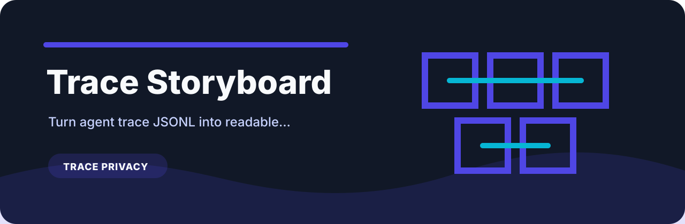

# Trace Storyboard



Turn agent trace JSONL into readable timelines and SVG storyboards.

`Python`

## Start here

```bash
git clone https://github.com/mertefekurt/trace-storyboard.git
cd trace-storyboard
python -m pip install -e ".[dev]"
trace-storyboard examples/agent-trace.jsonl
trace-storyboard examples/agent-trace.jsonl --format svg --output trace.svg
```

## Repository

[Open the source on GitHub →](https://github.com/mertefekurt/trace-storyboard)

[MIT License](LICENSE)
